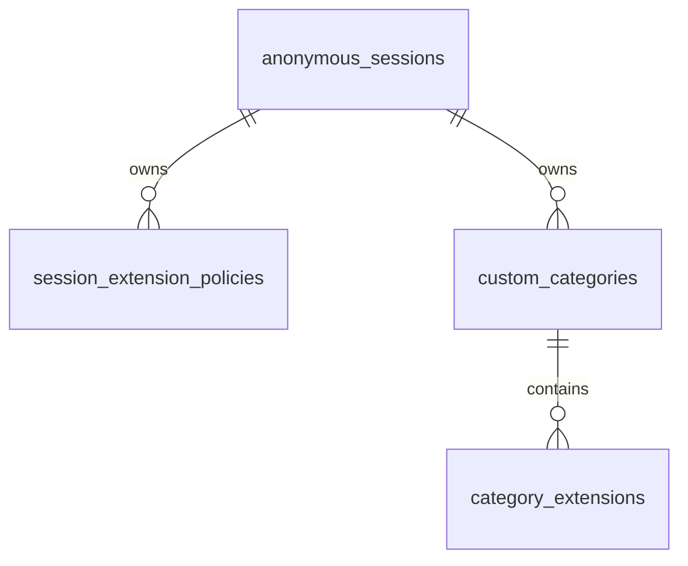

# DB 스키마 제출 설명

Cloudflare D1(SQLite)에 정책·세션·카테고리·누적 예산을 저장하고, 실제 파일은 비공개 R2에 저장한다. 이 문서는 과제의 컬럼/타입/제약/인덱스 제출 요건에 대응한다.

- 실제 변경 원본: [migrations/](migrations/)의0001~0005
- 제출용 통합 SQL: [schema.sql](schema.sql) — 위 migration을 순서대로 합친 동일 SQL
- 앱 로컬 초기화 명령: `pnpm run db:local`. 통합 SQL을 기존 DB에 중복 적용하는 방식은 사용하지 않는다.

## 관계와 초기화

세 외래키는 모두 `ON DELETE CASCADE`다. `upload_budget`은 세션과 독립된 앱 공통1행이며, `extension_policies`는 이전 전역 정책 보존용이다.

앱 테이블은 총6개다. D1이 관리하는 migration/내부 테이블은 이 제출용 앱 스키마에서 제외했다.

새 세션은 [server/session.ts](server/session.ts)의 D1 batch로 세션1행·고정 정책7행(`blocked=0`)·기본 카테고리4개/각5개 소속을 함께 생성한다. 커스텀은0개다. 같은 유효한 쿠키는 기존 행을 재사용하고 초기값을 다시 쓰지 않는다. 스키마 migration만으로 새 사용자 세션을 미리 만들지는 않는다.

## anonymous_sessions — 익명 세션

| 컬럼 | 타입 | 제약/기본값 | 의미 |
| --- | --- | --- | --- |
| id | TEXT | PRIMARY KEY, NOT NULL, length=64 | 서버 발급256비트 토큰의SHA-256 hex. DB CHECK 자체는 길이만 강제 |
| created_at | TEXT | NOT NULL, UTC `strftime` 기본값 | 세션 생성 시각 |

쿠키 원문·개인 신원·서버 만료 시각은 저장하지 않는다. 인덱스는 id PK다.

## session_extension_policies — 현재 제품의 확장자 정책

| 컬럼 | 타입 | 제약/기본값 | 의미 |
| --- | --- | --- | --- |
| session_id | TEXT | NOT NULL, anonymous_sessions(id) FK | 서버가 쿠키로 확정한 세션 |
| extension | TEXT | NOT NULL, length1~20, 소문자 ASCII 영숫자 | 점을 제외한 정규화 확장자 |
| kind | TEXT | NOT NULL, fixed/custom CHECK | 고정/커스텀 구분 |
| blocked | INTEGER | NOT NULL, 0/1 CHECK, custom이면1 | 실제 차단 상태 |
| created_at | TEXT | NOT NULL, UTC `strftime` 기본값 | 생성 시각 |
| updated_at | TEXT | NOT NULL, UTC `strftime` 기본값 | 마지막 변경 시각 |

- PK/인덱스: `(session_id,extension)` 복합PK. 세션별 조회/중복/개수 확인에 사용한다.
- 종류 CHECK: `bat,cmd,com,cpl,exe,scr,js`는 fixed만, 나머지는 custom만 허용한다.
- 고정 해제는 행 삭제가 아니라 `blocked=0`, custom 허용은 해당 행 삭제다.
- 세션당 커스텀200개는 컬럼 CHECK가 아니다. 단건 INSERT와 일괄 INSERT/UPSERT의 count 조건이 같은 DB의 경쟁 요청에도 상한을 지킨다. 직접 관리 SQL은 이 API 제약을 우회할 수 있다.
- 고정7행 누락/커스텀 초과 같은 불변식 오류는 정책 조회·업로드를503으로 중단한다.

## custom_categories — 기본·사용자 분류

| 컬럼 | 타입 | 제약/기본값 | 의미 |
| --- | --- | --- | --- |
| id | TEXT | PRIMARY KEY, NOT NULL | 사용자 분류UUID, 기본 분류는 세션과 builtin_key 조합 |
| session_id | TEXT | NOT NULL, anonymous_sessions(id) FK | 분류 소유 세션 |
| name | TEXT | NOT NULL, COLLATE NOCASE, length1~30 | 표시 이름 |
| builtin_key | TEXT | NULL 허용, photos/videos/audio/documents CHECK | 기본 분류 식별자. 사용자 분류는NULL |

- PK: id. UNIQUE `(session_id,name)`로 같은 세션 이름 중복을 막는다.
- 명시 인덱스 `category_builtin_per_session`: UNIQUE `(session_id,builtin_key)`. 사용자 분류의NULL은 여러 행 허용한다.
- 기본 이름/자체 삭제는 API에서 보호한다. 기본/사용자 분류의 소속 편집은 허용한다.
- 이름의 trim·제어문자/예약명 검사는 API에 있다. SQLite NOCASE의 기본 비교를 Unicode 전체 대소문자 정규화라고 설명하지 않는다.

## category_extensions — 분류 소속

| 컬럼 | 타입 | 제약/기본값 | 의미 |
| --- | --- | --- | --- |
| category_id | TEXT | NOT NULL, custom_categories(id) FK | 소속 분류 |
| extension | TEXT | NOT NULL, length1~20, 소문자 ASCII 영숫자 | 정책과 같은 정규화 문자열 |

복합PK/인덱스 `(category_id,extension)`로 한 분류 안의 중복을 막는다. 같은 확장자가 여러 분류에 속할 수 있다. 분류당50개 상한은 API 입력/원자적 INSERT에서 검사한다. 정책 테이블에 대한 FK는 두지 않는다. **소속 등록과 차단 등록은 독립**이므로 허용 확장자도 분류에 속할 수 있다.

## upload_budget — 앱 공통 누적 예약

| 컬럼 | 타입 | 제약/기본값 | 의미 |
| --- | --- | --- | --- |
| id | INTEGER | PRIMARY KEY, id=1 CHECK | singleton 행 |
| reserved_bytes | INTEGER | NOT NULL, 기본0, 0이상 CHECK | 허가한 저장 시도 바이트 합계 |
| reserved_puts | INTEGER | NOT NULL, 기본0, 0이상 CHECK | 허가한 저장 시도 횟수 |
| updated_at | TEXT | NOT NULL, UTC `strftime` 기본값 | 예약 갱신 시각 |

초기화는 `INSERT OR IGNORE`로 기존 값을 보존한다. 별도 인덱스는 없다. 256MiB/500회 상한은 원자적 조건부 UPDATE가 강제하며 DB CHECK에는 고정 상한이 없다. 실패·응답 유실·테스트 파일 정리에도 환급하지 않는다. 파일별 상태/저장 성공 테이블은 아니다.

## extension_policies — 이전 전역 정책 보존

컬럼은 extension(TEXT PK), kind(TEXT), blocked(INTEGER), created_at(TEXT), updated_at(TEXT)다. 모두NOT NULL이며 문자열/종류/차단 CHECK와 시각 기본값은 현재 정책 테이블에서 session_id를 뺀 형태다. 고정7개를 `INSERT OR IGNORE`로 만들었다. 현재 API는 이 테이블을 읽거나 쓰지 않고 세션별 정책만 사용한다. 새 세션에 이전 전역 체크 상태를 복사하지 않는다.

## R2와 DB 경계

파일은 `uploads/<UUID>` 키와 `application/octet-stream` 메타데이터로 비공개 R2에 저장한다. 원본명·업로드 상태·파일 본문을 D1에 넣지 않는다. 저장 전 해당 세션의 정책을 읽은 시점T와 예산 예약을 거치며, D1 예약과 R2 put이 하나의 트랜잭션인 것은 아니다.

## 실제 검증

[로컬 Worker 검사](tests/integration/)에서 실제 D1의 CHECK/PK/FK·동일DB 상한 경쟁·제약 실패 rollback과 R2 바이트를 확인했다. 운영 환경의 migration1~5 적용/FK·불변식 결과는 [원격 D1 증거](.docs/verification/RELEASE-20261023-d1-environment.json), 운영 저장/정리는 [실제 저장 증거](.docs/verification/RELEASE-20261023-storage.json)에 기록했다. 이번 제출 SQL 준비 검사는 앱 기능 테스트와 구분한다.
